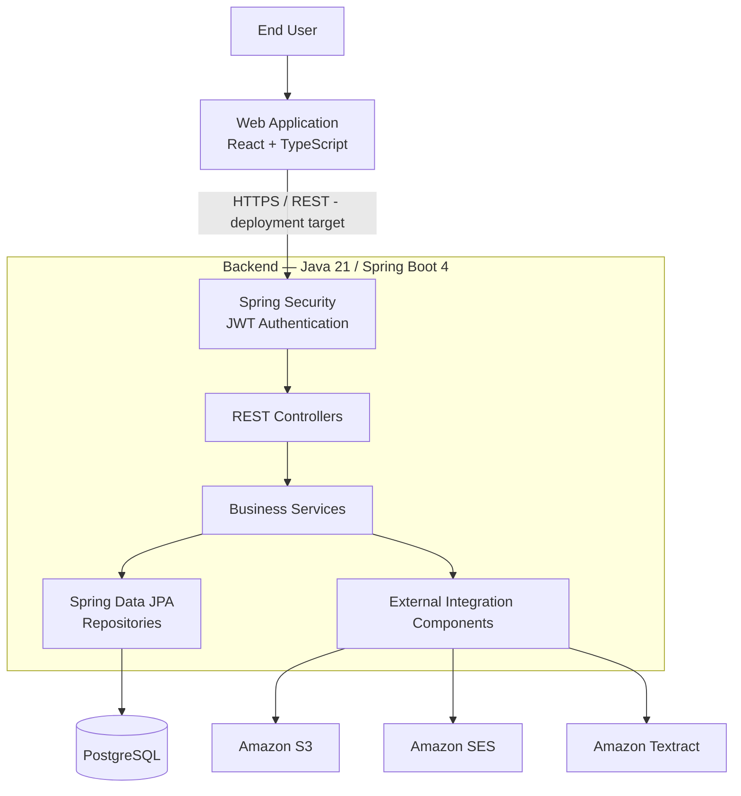
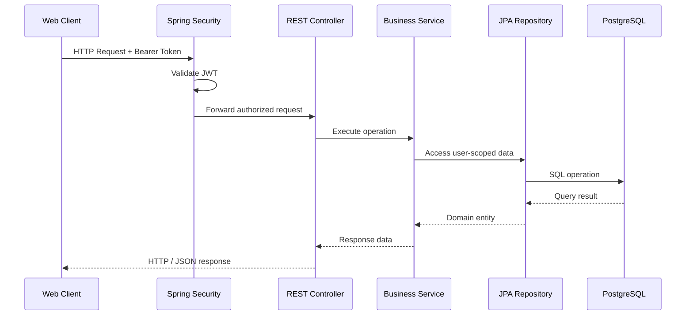

# FinPath — Software Architecture

**Technical Architecture & Engineering Decisions**

> **Project:** FinPath — Personal Finance Management Platform  
> **Architecture:** Layered Monolithic Application  
> **Backend:** Java 21 / Spring Boot 4  
> **Frontend:** React / TypeScript  
> **Database:** PostgreSQL  
> **Status:** Active Development

---

## 1. Architecture Overview

FinPath is a personal finance management platform designed to provide secure financial data management, transaction processing, financial planning, and analytical capabilities.

The backend follows a layered monolithic architecture, separating HTTP communication, business logic, data persistence, and external integrations.

This approach prioritizes maintainability, clear responsibilities, and controlled complexity during the initial product development stages.

The architecture supports incremental product evolution without introducing unnecessary distributed-system complexity.

### High-Level Architecture

**Note:** This diagram represents the application's logical architecture. HTTPS deployment and cloud infrastructure are part of the deployment strategy; the diagram does not imply that the application is already publicly deployed.

---

## 2. Backend Architecture

The backend is organized into packages with distinct responsibilities.

| Layer | Responsibility |
|---|---|
| Controller | HTTP endpoints and request handling |
| Service | Business logic and application workflows |
| Repository | Database access and persistence |
| Model | Domain entities and relationships |
| DTO | API request and response contracts |
| Security | Authentication and request filtering |
| Validation | Input and business validation |
| Exception | Application error handling |
| Configuration | Framework and integration configuration |
| Integration | Email, storage, and document processing |

### Request Processing

A typical authenticated request follows this logical flow:

This separation allows business rules to remain independent of HTTP request handling.

---

## 3. Authentication and Security

FinPath implements stateless authentication using Spring Security and JSON Web Tokens.

### Authentication Components

- Spring Security filter chain.
- Custom JWT authentication filter.
- JWT generation and validation service.
- BCrypt password encoder.
- Configurable token expiration.
- Centralized handling of unauthenticated requests.

### JWT Authentication

Authentication tokens contain the user's email as the subject, along with issuance and expiration timestamps.

Tokens are cryptographically signed using a configured secret key.

Protected requests use the following authorization scheme:

`Authorization: Bearer <JWT_TOKEN>`

The authentication filter validates the token and establishes the authenticated identity within the Spring Security context.

### Access Control

The security configuration distinguishes between public and authenticated endpoints.

Public routes include registration, login, password recovery, health checks, and API documentation.

Other application routes require authentication.

### User Data Isolation

Financial operations use the authenticated user as part of their data-access criteria.

Examples include:

- Retrieving accounts belonging to the authenticated user.
- Retrieving transactions associated with that user.
- Validating category ownership before creating transactions.
- Restricting transaction updates and deletions by user.

This design helps prevent unauthorized cross-user access to financial records.

### Security Considerations

The application uses stateless session management.

CSRF protection is disabled in the current backend configuration. Its suitability depends on the frontend authentication and credential-storage strategy.

Additional security considerations for production include:

- Secure management of signing secrets.
- HTTPS enforcement.
- Appropriate token storage and expiration policies.
- Review of publicly accessible API documentation.
- Verification of authorization boundaries across endpoints.

---

## 4. Financial Domain

The backend contains domain components for:

- Users.
- Financial accounts.
- Categories.
- Income and expense transactions.
- Recurring transactions and occurrences.
- Budgets.
- Savings goals.
- Financial projections.
- Monthly financial history.
- Financial insights.
- Receipts and document processing.

These components support the product's core objective of helping users organize and understand their finances.

### Transaction Management

The transaction service implements domain validations such as:

- Account ownership verification.
- Category ownership verification.
- Compatibility between transaction and category types.
- Transaction date restrictions based on account reference dates.
- Restrictions on modifying transactions linked to recurring occurrences.
- Restrictions on deleting transactions with associated receipts.

These rules are enforced within the application service layer.

---

## 5. Data Persistence

FinPath uses PostgreSQL as its primary relational database.

Spring Data JPA provides the persistence abstraction.

Flyway is included for database schema migrations.

### Persistence Design

The backend uses:

- JPA entities.
- Repository interfaces.
- JPQL queries.
- Pagination and sorting.
- Dynamic query specifications.
- Entity graphs for relationship loading.
- Transaction management.

### Financial Calculations

Financial calculations use Java's `BigDecimal` type for decimal monetary values.

Database queries support:

- Income and expense aggregation.
- Account balance calculations.
- Category-based expense analysis.
- Period-based financial summaries.
- Financial projection inputs.

### Query Optimization

Selected repository queries use JPA entity graphs to load related accounts and categories.

This can reduce unnecessary additional database queries when retrieving transaction information.

---

## 6. Transaction Consistency and Concurrency

Financial applications require careful handling of concurrent operations and data consistency.

FinPath uses Spring transaction management for selected database operations.

### Pessimistic Locking

The transaction repository includes a query configured with:

`LockModeType.PESSIMISTIC_WRITE`

This query is used during transaction deletion.

The associated service operation runs within a transactional boundary.

The locking strategy helps coordinate concurrent database operations affecting the selected financial record.

### Business Integrity

Before deleting a transaction, the application checks whether it is associated with:

- A recurring transaction occurrence.
- Stored receipts.

These checks help preserve relationships between financial records.

Concurrency behavior and transaction boundaries remain areas for continued testing and validation.

---

## 7. API Design

FinPath exposes RESTful endpoints through Spring MVC controllers.

The application uses dedicated DTOs to represent requests and responses.

### API Capabilities

The backend includes controllers for:

- Authentication and users.
- Accounts and categories.
- Transactions.
- Recurring transactions.
- Budgets and goals.
- Financial projections.
- Dashboard and monthly history.
- Financial insights.
- Receipts and OCR processing.

### Pagination and Filtering

Transaction queries support pagination, sorting, and filtering.

The service validates pagination limits and financial filter parameters before executing queries.

### API Documentation

The project includes Springdoc OpenAPI for API documentation.

This supports the maintenance and exploration of API contracts during development.

---

## 8. AWS Integrations

The backend includes integration components for Amazon Web Services.

### Amazon S3

The project contains storage components for managing financial receipt files.

S3 is used as the storage integration technology.

### Amazon SES

The project includes an email-sending abstraction and an Amazon SES implementation.

Email delivery supports application workflows such as password recovery.

### Amazon Textract

The backend includes components for extracting financial information from receipt documents.

OCR functionality is under development and is not intended to be enabled for end users in the initial release.

### Document Processing

Apache PDFBox is included as a document-processing dependency.

Receipt validation and OCR extraction components are organized separately from the core financial services.

---

## 9. Testing and Quality

The backend includes dependencies for:

- Spring Boot testing.
- Spring Security testing.
- JPA testing.
- Validation testing.
- H2.
- Testcontainers.
- PostgreSQL integration testing.

The Maven test configuration explicitly disables SES email delivery during test execution.

This helps isolate automated tests from external email side effects.

The presence of these dependencies does not, by itself, establish test coverage or successful execution. Test evidence and coverage metrics will be documented separately.

---

## 10. Architectural Decisions

### ADR-001 — Layered Monolithic Architecture

**Decision:** Use a layered monolithic backend.

**Rationale:**

- Reduce initial infrastructure complexity.
- Support rapid MVP development.
- Keep business logic organized.
- Simplify local development and debugging.
- Preserve opportunities for future architectural evolution.

### ADR-002 — Stateless JWT Authentication

**Decision:** Use Spring Security with JWT-based authentication.

**Rationale:**

- Separate authentication from server-side HTTP sessions.
- Support REST API consumption.
- Establish a consistent authentication mechanism.
- Enable protected financial operations.

### ADR-003 — PostgreSQL and Spring Data JPA

**Decision:** Use PostgreSQL with Spring Data JPA.

**Rationale:**

- Support relational financial data.
- Provide transactional database operations.
- Model domain relationships.
- Support structured queries and financial aggregations.

### ADR-004 — BigDecimal for Monetary Values

**Decision:** Use `BigDecimal` for financial amounts.

**Rationale:**

- Avoid binary floating-point representation issues.
- Support decimal precision.
- Improve reliability in monetary calculations.

### ADR-005 — Separate External Integrations

**Decision:** Organize storage, email, and OCR integrations into dedicated components.

**Rationale:**

- Separate external services from core business logic.
- Improve maintainability.
- Support testing and future implementation changes.

---

## 11. Architecture Evolution

The following areas are part of the project's ongoing technical evolution:

- Cloud infrastructure and deployment.
- Separate development and production environments.
- Expanded automated testing.
- Application monitoring and observability.
- Security hardening.
- Performance validation.
- Receipt-processing improvements.
- Mobile application integration.

These items represent development objectives and should not be interpreted as completed production capabilities.

---

## 12. Source Code and Intellectual Property

FinPath is being developed as a proprietary commercial product.

The complete source code is maintained in a private repository.

This public portfolio presents selected architectural concepts, engineering decisions, and technical documentation without disclosing proprietary implementation details, credentials, or production configurations.

---

**FinPath — Software Engineering, Financial Technology & Product Development**
