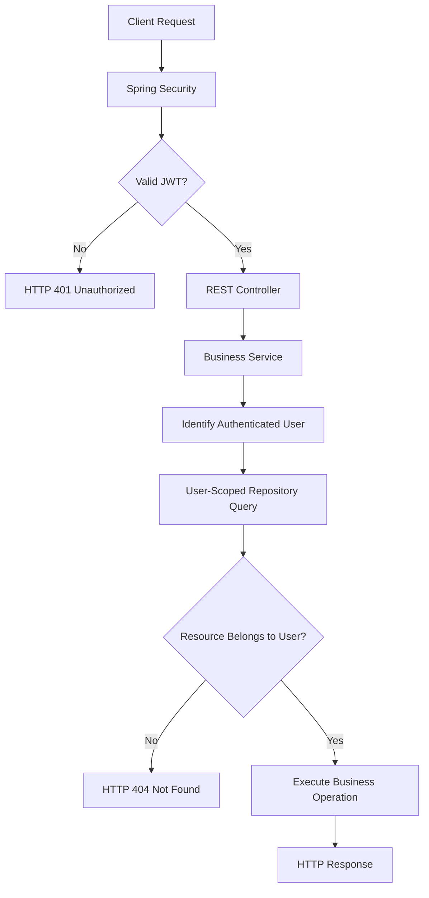

# Case Study 01 — Secure Financial Data Isolation

**Designing and validating user-level access controls in a financial application**

**Project:** FinPath — Personal Finance Management Platform  
**Role:** Founder | Product Owner | Full Stack Developer  
**Technologies:** Java 21, Spring Boot 4, Spring Security, JWT, Spring Data JPA, PostgreSQL, JUnit 5, MockMvc  
**Status:** Implemented and integration-tested  
**Validation date:** October 28, 2026

---

## 1. Executive Summary

FinPath is a personal finance management platform designed to help users manage financial accounts, transactions, budgets, and financial goals.

One of the key engineering challenges in developing the platform was ensuring that financial information remained isolated between users.

In a multi-user financial application, authentication alone is insufficient. The system must also verify whether an authenticated user is authorized to access or modify a specific financial resource.

To address this challenge, I implemented a security approach combining:

- JWT-based authentication.
- User-scoped database queries.
- Account and category ownership validation.
- Business rules enforced in the service layer.
- Automated API integration tests.

The implementation was validated through a targeted integration test suite.

**Verified result: 14 tests executed, 14 passed, 0 failures, and 0 errors.**

---

## 2. Business Problem

Financial applications handle sensitive information, including account balances, income, expenses, and transaction histories.

A fundamental requirement is that each user can access only their own financial records.

Consider a scenario involving two users:

**User A**
- Owns a checking account.
- Registers income and expense transactions.
- Creates financial categories.

**User B**
- Has a separate account.
- Authenticates successfully.
- Attempts to access a transaction belonging to User A.

Even though User B is authenticated, they must not be allowed to access User A's financial information.

This creates an important distinction:

**Authentication answers: "Who is the user?"**

**Authorization answers: "What is this user allowed to access?"**

The challenge was to enforce both consistently throughout the transaction management workflow.

---

## 3. Engineering Objectives

The implementation was designed to satisfy the following requirements:

1. Require authentication for protected financial endpoints.
2. Associate financial resources with their respective owners.
3. Restrict transaction queries to the authenticated user.
4. Prevent users from accessing transactions owned by others.
5. Prevent transactions from referencing accounts owned by other users.
6. Prevent transactions from referencing categories owned by other users.
7. Enforce financial validation rules.
8. Verify the expected behavior through automated integration tests.

These requirements help establish a foundation for secure financial data management.

---

## 4. Solution Architecture

The solution uses Spring Security for authentication and application-level ownership checks for resource authorization.

### Logical Security Flow



This diagram illustrates the logical authorization flow for a protected resource lookup. Actual responses may also depend on request validation and business rules.

### Authentication Layer

Spring Security processes incoming requests through a configured security filter chain.

JWT tokens are used to establish the authenticated user's identity.

Protected API operations require a valid authentication context.

### Business Service Layer

The service layer is responsible for applying business rules and checking resource ownership.

Before performing a transaction operation, the application resolves the authenticated user and accesses the relevant resources using user-scoped repository methods.

### Persistence Layer

Spring Data JPA repositories provide methods that include the authenticated user in their selection criteria.

This helps prevent transactions belonging to another user from being returned by protected resource queries.

---

## 5. User-Scoped Data Access

One of the central design decisions was to incorporate resource ownership into database access operations.

Instead of retrieving a transaction solely by its identifier, the application retrieves it using both:

- The transaction identifier.
- The authenticated user.

### Conceptual Example

```text
Find transaction where:

    transaction.id = requested_id

AND transaction.owner = authenticated_user
```

This is a simplified representation of the authorization strategy, not a reproduction of proprietary source code.

### Why This Matters

A transaction identifier alone does not establish authorization.

For example, a request such as:

`GET /api/transactions/123`

must not return a transaction merely because record `123` exists.

The application must also verify that the record belongs to the authenticated user.

If the ownership criteria are not satisfied, the protected lookup returns no matching resource.

In the tested scenario, the API responds with:

**HTTP 404 — Not Found**

This prevents the endpoint from returning another user's transaction details.

---

## 6. Account and Category Ownership

Transaction creation requires references to financial accounts and categories.

These references introduce additional authorization requirements.

A user must not be able to create a transaction using another user's account or category.

### Account Ownership Validation

The application validates that the selected account belongs to the authenticated user.

An attempt to use another user's account is rejected.

### Category Ownership Validation

The application also verifies that the selected financial category belongs to the authenticated user.

An attempt to reference another user's category is rejected.

### Financial Category Compatibility

Beyond ownership, the application checks whether the category type is compatible with the transaction type.

For example:

- Income transactions must use compatible income categories.
- Expense transactions must use compatible expense categories.

This prevents invalid combinations from being persisted.

---

## 7. Additional Financial Integrity Controls

The transaction service implements additional business rules to protect financial consistency.

### Monetary Validation

Transactions with zero or negative amounts are rejected.

The application uses `BigDecimal` for monetary values.

### Account Reference Dates

Transaction dates are validated against the account's balance reference date when that reference is configured.

This supports the application's temporal balance calculation rules.

### Recurring Transactions

Transactions associated with recurring occurrences have restrictions on direct modification or deletion.

These restrictions help preserve consistency between recurring schedules and their financial records.

### Receipt Relationships

Transactions associated with stored receipts cannot be deleted until the related receipt constraints are satisfied.

This helps preserve the integrity of financial records and their associated documents.

---

## 8. Transaction Consistency and Concurrency

The transaction repository includes a user-scoped lookup configured with pessimistic write locking.

The corresponding deletion operation is executed within a transactional boundary.

### Architectural Decision

Use a database-level pessimistic write lock when retrieving a transaction for deletion.

### Rationale

This strategy helps coordinate concurrent operations involving the selected record.

It also provides a transactional context for evaluating business constraints before deletion.

### Important Consideration

The locking mechanism is an additional consistency measure.

It does not replace authorization checks, database constraints, or automated concurrency testing.

---

## 9. Integration Testing Strategy

The implementation was validated using:

- JUnit 5.
- Spring Boot Test.
- Spring Security.
- MockMvc.
- Automated HTTP request assertions.

The integration test class exercises the application through its HTTP endpoints.

The tests include user registration, login, authenticated requests, and validation of API responses.

### Security Test Scenarios

| Scenario | Expected Result | Verified in Test Suite |
|---|---|---|
| Access protected endpoint without authentication | HTTP 401 | Yes |
| Access another user's transaction | HTTP 404 | Yes |
| Create transaction using another user's account | HTTP 404 | Yes |
| Create transaction using another user's category | HTTP 404 | Yes |
| Create transaction with incompatible category type | HTTP 400 | Yes |
| Create transaction with zero amount | HTTP 400 | Yes |
| Create transaction with negative amount | HTTP 400 | Yes |

### Functional Test Scenarios

The suite also validates:

- Successful income creation.
- Successful expense creation.
- Transaction listing.
- Transaction retrieval by identifier.
- Transaction updates.
- Transaction deletion.
- Account balance calculation after financial movements.

These tests validate both security-related behavior and core financial functionality.

---

## 10. Test Execution Evidence

**Test class:** `TransactionControllerIntegrationTest`

**Execution date:** October 28, 2026

### Maven Test Results

```text
Tests run: 14
Failures: 0
Errors: 0
Skipped: 0

BUILD SUCCESS

Total time: 22.710 s
```

### Validation Outcome

**14 / 14 tests passed successfully.**

The results confirm that all scenarios in the selected integration test class passed during this execution.

This is targeted test evidence and should not be interpreted as a complete security audit or a guarantee that all application modules are free of defects.

---

## 11. Technical Decisions and Trade-offs

### Decision 1 — Enforce Ownership in Repository Queries

**Approach:** Include the authenticated user in resource lookup criteria.

**Benefit:** Restricts access to records associated with the current user.

**Trade-off:** Authorization rules must be applied consistently across relevant service and repository operations.

### Decision 2 — Separate Authentication and Authorization

**Approach:** Use Spring Security for authentication and application services for resource-level ownership validation.

**Benefit:** Keeps business authorization close to domain operations.

**Trade-off:** Requires careful testing of cross-user access scenarios.

### Decision 3 — Validate Relationships Before Persistence

**Approach:** Check account ownership, category ownership, and category compatibility before creating transactions.

**Benefit:** Reduces the risk of inconsistent or unauthorized financial relationships.

**Trade-off:** Introduces additional validation steps during transaction processing.

### Decision 4 — Validate Through HTTP Integration Tests

**Approach:** Exercise protected endpoints using authenticated and unauthenticated HTTP requests.

**Benefit:** Verifies behavior across multiple application layers.

**Trade-off:** Integration tests require more setup and execution time than isolated unit tests.

---

## 12. Results and Engineering Impact

The implementation establishes important controls for financial data isolation.

### Verified Outcomes

- Protected transaction endpoints reject unauthenticated requests in the tested scenario.
- Cross-user transaction retrieval is rejected.
- Cross-user account references are rejected during transaction creation.
- Cross-user category references are rejected during transaction creation.
- Invalid monetary values and category combinations are rejected.
- Core transaction operations pass the selected integration tests.
- The financial balance calculation produces the expected result in the tested scenario.

### Engineering Value

This case study demonstrates practical experience in:

**Backend Engineering**
- REST API development.
- Service-layer business logic.
- Spring Data JPA.
- Transaction management.

**Application Security**
- JWT authentication.
- Resource-level authorization.
- User-scoped database access.
- Multi-user data isolation.

**Software Quality**
- Integration testing.
- HTTP response validation.
- Negative test scenarios.
- Financial business rule validation.

**Product Engineering**
- Translating financial security requirements into technical controls.
- Prioritizing protection of user data.
- Validating critical application behavior before release.

---

## 13. Future Improvements

Potential next steps include:

- Expanding explicit cross-user authorization tests for transaction updates and deletions.
- Reviewing authorization coverage across all financial endpoints.
- Expanding concurrency test coverage.
- Introducing additional security regression tests.
- Measuring test coverage.
- Strengthening production security configuration and monitoring.

These improvements are part of ongoing engineering work and are not presented as completed capabilities.

---

## 14. Conclusion

Developing a financial application requires more than implementing CRUD operations.

Each financial resource must be protected by authentication, ownership validation, and consistent business rules.

In FinPath, I addressed these requirements through a combination of Spring Security, JWT authentication, user-scoped persistence queries, service-layer validation, and automated integration testing.

The resulting implementation demonstrates how security requirements can be translated into concrete engineering decisions and validated through repeatable tests.

**Verified result: 14 integration tests passed with zero failures and zero errors.**

---

### About the Project

FinPath is an independently developed financial technology project.

I am responsible for product planning, technical architecture, backend development, frontend development, and the product roadmap.

The source code is maintained in private repositories as part of the project's proprietary development strategy.

This case study documents selected technical decisions and verified results without disclosing proprietary implementation details.

**FinPath | Software Engineering · FinTech · Product Development**
