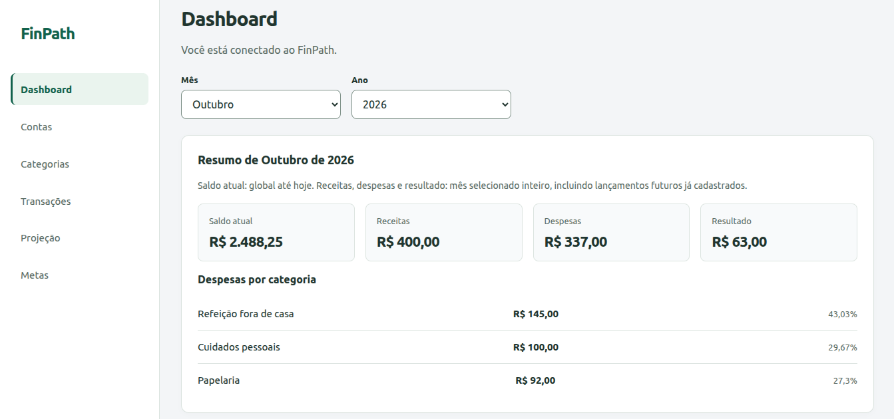
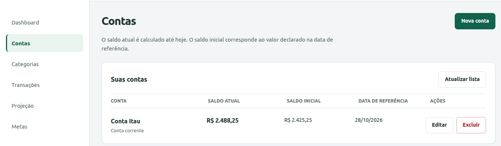
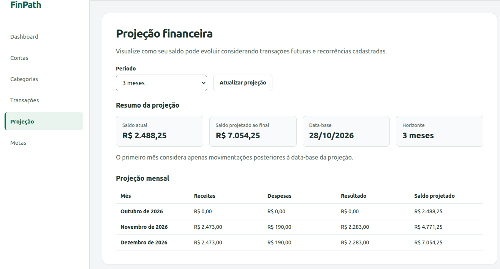
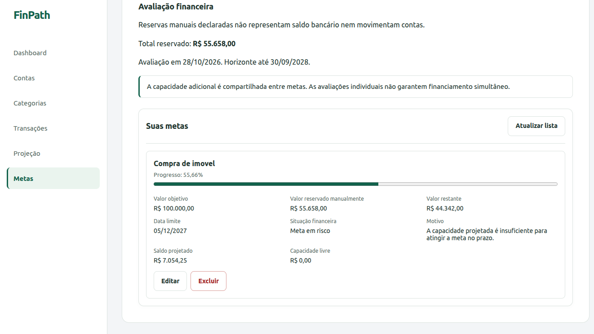

# FinPath
### Personal Finance Management Platform

**Full Stack Software Engineering | Product Ownership | Financial Technology**

FinPath is an independent fintech project focused on building a modern personal finance management platform.

The application helps users organize financial accounts, track income and expenses, monitor balances, and gain better visibility into their financial lives.

The project combines software engineering, product management, financial domain knowledge, and cloud technologies.

> **Project Status:** Active Development  
> **Source Code:** Private — Proprietary Product  
> **Portfolio:** Public Technical Documentation

---

## 1. Project Overview

FinPath was conceived as a scalable digital financial management solution, initially focused on personal finance.

The platform is being developed as a responsive web application, with future plans for Android and iOS applications.

The long-term product vision includes financial automation, artificial intelligence, receipt processing, and Open Finance integrations.

## Technical Documentation

Explore the architecture, engineering decisions, and technical challenges behind FinPath.

| Document | Description |
|----------|-------------|
| [Software Architecture](ARCHITECTURE.md) | Explore the layered architecture, JWT authentication, PostgreSQL persistence, AWS integrations, and key engineering decisions. |
| [Case Study 01 — Secure Financial Data Isolation](CASE_STUDY_01.md) | Learn how user-level authorization was implemented and validated through 14 successful integration tests. |

These documents provide insight into my work as a **Full Stack Developer and Product Owner**, connecting business requirements, software architecture, implementation, and automated testing.

## Application Screenshots

FinPath features a web interface developed with React and TypeScript, designed to help users monitor their financial activities and make informed decisions.

### Financial Dashboard

The dashboard provides an overview of the user's financial position, including account balances, monthly income, expenses, and spending distribution by category.



*FinPath financial dashboard displaying sample data for demonstration purposes.*

### Account Management

FinPath allows users to manage financial accounts, monitor their current balances, and maintain an initial balance reference for accurate financial tracking.



*Account management interface displaying fictional financial data.*

**Key capabilities:**
- Create, view, update, and delete financial accounts.
- Track initial and current account balances.
- Configure balance reference dates.
- Monitor account balances based on recorded financial transactions.

### Financial Projection

FinPath helps users anticipate their financial position by calculating projected balances based on future transactions and recurring financial activities.

Users can select a projection horizon and analyze how expected income and expenses may affect their financial position over time.



*Financial projection interface displaying fictional financial data over a three-month planning horizon.*

**Key capabilities:**
- Financial projections based on future transactions and recurring activities.
- Configurable projection horizon.
- Monthly income and expense forecasts.
- Projected financial results.
- Month-by-month balance evolution.
- Clear distinction between current and projected balances.

### Financial Goals

FinPath helps users define financial goals, track savings progress, and assess whether their financial capacity is sufficient to achieve their objectives within a specified deadline.



*Financial goals interface displaying fictional data and a goal feasibility assessment.*

**Key capabilities:**
- Create, update, and delete financial goals.
- Define target amounts and deadlines.
- Track manually allocated savings.
- Monitor goal completion percentages.
- Calculate remaining amounts.
- Evaluate financial feasibility based on projected financial capacity.
- Identify goals at risk of not being achieved within their deadlines.

The financial assessment considers the available projection horizon and provides an explanation when a goal is classified as at risk.

Manually allocated savings are tracked separately and do not directly modify bank account balances.

### Key Features Demonstrated

- Monthly financial overview.
- Current account balance.
- Income and expense summaries.
- Monthly financial results.
- Expense distribution by category.
- Month and year selection.
- Navigation between financial management modules.


### Business Objectives

- Simplify personal financial management.
- Provide visibility into financial accounts and transactions.
- Help users understand their financial behavior.
- Support financial planning and decision-making.
- Build a scalable platform for future intelligent financial services.

---

## 2. My Role

**Founder | Product Owner | Full Stack Developer**

I am responsible for the product lifecycle, from initial concept and requirements definition to architecture, development, testing, and technical documentation.

### Product Ownership

- Define product vision and business objectives.
- Identify user needs and translate them into functional requirements.
- Define and prioritize the Minimum Viable Product (MVP).
- Manage the product backlog and development roadmap.
- Write user stories and acceptance criteria.
- Evaluate technical feasibility and business value.
- Plan future product monetization strategies.

### Software Engineering

- Design the application architecture.
- Develop RESTful APIs using Java and Spring Boot.
- Implement authentication and authorization mechanisms.
- Design relational database models using PostgreSQL.
- Develop frontend components using React and TypeScript.
- Implement business rules for financial transactions.
- Create automated tests.
- Integrate external services and cloud technologies.

---

## 3. Technology Stack

### Backend
- Java 21
- Spring Boot
- Spring Security
- Spring Data JPA
- REST APIs
- JWT Authentication
- Maven

### Frontend
- React
- TypeScript
- Vite

### Database
- PostgreSQL
- Flyway
- SQL

### Cloud & Infrastructure
- Amazon Web Services (AWS)
- Amazon SES
- Docker
- Git
- GitHub

### Development Practices
- Agile Product Development
- Product Backlog Management
- API Design
- Relational Data Modeling
- Automated Testing
- Technical Documentation

---

## 4. Solution Architecture

FinPath follows a layered application architecture that separates user interfaces, business logic, persistence, and external integrations.

```text
                  USERS
                    |
                    v
              WEB APPLICATION
              React + TypeScript
                    |
                    v
                 REST APIs
                    |
                    v
              SPRING BOOT
                  Java 21
                    |
          +---------+---------+
          |         |         |
          v         v         v
      Security   Business    External
        JWT      Services  Integrations
          |         |         |
          +---------+---------+
                    |
                    v
               PostgreSQL
                    |
                    v
                 Flyway
```

The architecture is designed to support future scalability, cloud deployment, and integration with additional financial services.

---

## 5. Product Features

FinPath is under active development. The features below are categorized according to their current implementation and validation status.

### Implemented Features

**Authentication and Security**
- User registration and login.
- JWT-based authentication.
- Secure password hashing.
- User-level data isolation and authorization.
- Input validation and standardized error handling.

**Financial Management**
- Financial account management.
- Income and expense transaction management.
- Transaction filtering and pagination.
- Financial dashboard with monthly summaries.
- Expense aggregation by category.
- Current and historical balance calculations.
- Monthly financial history.

**Financial Planning**
- Recurring financial transactions.
- Financial projections based on future and recurring transactions.
- Configurable projection horizons.
- Savings goals with target amounts and deadlines.
- Goal progress tracking.
- Financial feasibility assessments for savings goals.

**Engineering and Quality**
- REST API development with Spring Boot.
- PostgreSQL persistence using Spring Data JPA.
- Database schema migrations with Flyway.
- Automated unit and integration tests.
- PostgreSQL integration testing with Testcontainers.
- OpenAPI documentation.

### Implemented — Additional Validation or Release Configuration Required

- Password recovery and reset flow.
- Receipt storage and management.
- OCR-based receipt processing, currently intended to remain disabled for end users at initial launch while accuracy improvements are developed.
- AWS integrations for email delivery and document processing.

These capabilities require additional end-to-end validation, configuration, or release-readiness checks before being considered production-ready.

### Planned Features

- Mandatory email verification during registration.
- Public cloud deployment with separate development and production environments.
- Open Finance integrations.
- AI-assisted financial automation.
- Advanced receipt processing.
- Messaging-based financial transaction registration.
- Native Android and iOS applications.

**Project status:** Active development. Implemented functionality does not necessarily indicate production readiness.


## 6. Product Management

FinPath is developed using an iterative product delivery approach.

### MVP Strategy

The initial MVP focuses on delivering essential personal financial management capabilities.

Core priorities include:

1. Secure user registration and authentication.
2. Financial account management.
3. Income and expense tracking.
4. Financial dashboard and transaction history.
5. Password recovery.
6. Application usability and stability.

### Product Roadmap

**Phase 1 — Core Platform**
- Backend architecture.
- Authentication and authorization.
- Financial accounts and transactions.
- Web dashboard.

**Phase 2 — Financial Management**
- Recurring transactions.
- Financial projections.
- Savings goals.
- Receipt management.

**Phase 3 — Cloud Deployment**
- AWS infrastructure.
- Development and production environments.
- Security and monitoring.
- Public web application.

**Phase 4 — Intelligent Financial Services**
- OCR processing.
- Open Finance.
- AI-powered automation.
- Messaging integrations.
- Mobile applications.

---

## 7. Product Strategy

FinPath is designed with a freemium business model.

### Free Version

The initial release will provide essential financial management features to attract users, validate the product, and collect feedback.

### Future Premium Version

Potential premium capabilities include:

- Intelligent receipt processing.
- AI-assisted transaction registration.
- Advanced financial insights.
- Messaging-based financial automation.
- Additional integrations.

These capabilities are part of the product vision and are not commitments to a specific release date.

---

## 8. Technical Challenges

The project addresses engineering challenges commonly found in financial applications:

- Designing secure authentication flows.
- Maintaining consistency in financial calculations.
- Modeling transactions and account balances.
- Managing recurring financial events.
- Integrating frontend and backend services.
- Handling application errors consistently.
- Designing maintainable and scalable APIs.
- Preparing infrastructure for cloud deployment.

Technical decisions and implementation details will be documented through architecture notes and case studies.

---

## 9. Source Code Availability

FinPath is being developed as a proprietary commercial product.

The source code is maintained in a private repository.

This public repository provides technical documentation, architecture overviews, selected implementation examples, product management artifacts, and development case studies.

Sensitive information, credentials, proprietary business logic, and production configurations are not publicly disclosed.

---

## 10. Project Evolution

FinPath is an actively evolving project.

Future updates to this portfolio will include:

- Architecture diagrams.
- Application screenshots.
- API documentation examples.
- Product backlog examples.
- Technical case studies.
- Testing strategies.
- Cloud deployment architecture.

---

**FinPath — Building smarter personal financial experiences.**
